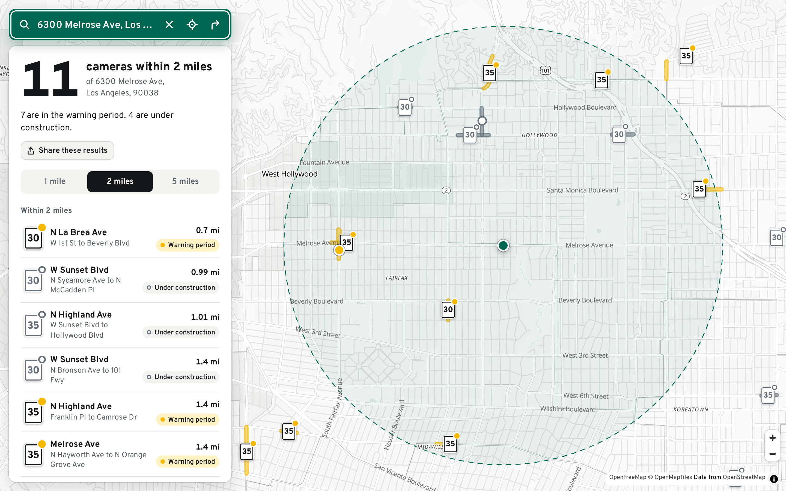

# LA speed cameras near you

Enter an address. The map counts the Los Angeles speed cameras near it and shows where each one stands.

Or map a drive, such as a commute. The map counts the cameras on the route, in driving order.

This is not a city website. The camera data comes from LADOT.

Live site: https://laspeedcams.com



## Run it

The site is static. It has no build step and no API key.

```bash
python3 -m http.server 4173 --bind 127.0.0.1
```

Open http://localhost:4173. The page must come from a web server: the map worker does not load from a `file://` path.

## Test it

```bash
npm install
```

```bash
npm test
```

`npm test` runs four suites at the same time and prints one line for each.

| Suite | Command | What it checks |
| --- | --- | --- |
| lint | `npm run test:lint` | The scripts parse |
| unit | `npm run test:unit` | `lib.js` (status, distance, address matching, live-data merge, sign layout, routes) and the files in `data/` |
| build | `npm run test:py` | The join in `scripts/build_data.py` |
| browser | `npm run test:e2e` | The page in Chromium and WebKit at six screen sizes, with an axe accessibility scan of each view |

The browser suite fakes every outside host (`tests/e2e/mocks.js`), so it needs no network. It starts its own server on port 4174.

The route tests use real routes saved in `tests/fixtures/routes.json`. `node scripts/fetch_route_fixtures.mjs` fetches them again.

GitHub Actions runs the same four suites on each push (`.github/workflows/tests.yml`).

## Where the data comes from

| What | Source |
| --- | --- |
| Cameras and their status | LADOT's Speed Safety System map, read live on each page load |
| Corridors, speed limits, city limits | A saved copy of LADOT's layers in `data/` |
| Address search | Los Angeles County's address finder (CAMS). Photon adds places the county finder lacks, and answers when it is down |
| Routes | Valhalla on the German OpenStreetMap group's server (`valhalla1.openstreetmap.de`). OSRM on `routing.openstreetmap.de` answers when Valhalla is down |
| Map tiles | OpenFreeMap (OpenStreetMap data) |

When LADOT's live data does not load, or its fields change, the page keeps the saved copy and says so under the panel.

## How it counts

- A camera watches a stretch of street. LADOT's point is only a label on that stretch. The distance from an address goes to the nearest part of the stretch.
- Enter picks an address only when one strong match exists. When several places tie, or the text is vague, the page shows the choices.
- A drive counts a camera when the route runs along the stretch of street the camera watches. A route that only cuts across the stretch, or passes over it on a freeway, does not count: the page lists those streets apart. When the two are hard to tell apart, the camera counts.
- A drive shows two routes when they differ: the fastest, and one that avoids freeways. Every camera stands on a city street, so the fastest route alone can read "0 cameras" for a trip that passes several on city streets.
- Drive times are without traffic. The route services know no traffic.
- A status label repeats LADOT's listing. The data has no switch-on dates, so the page does not say when fines start for a camera.

## Safety rules in the code

- The page has a content security policy (the `meta` tag at the top of `index.html`). It lets the page run code only from this site and call only the services it names. Add a new service's host there, or the browser blocks it.
- `vercel.json` adds headers that stop other sites from framing the page and limit device permissions to location.
- Text from outside services goes through `esc` before it enters the page.
- A camera position from LADOT outside greater Los Angeles is not trusted: the camera keeps its saved place. A route outside California, or longer than 600 miles, is rejected.
- The web address holds the current search or drive, so a link can be shared. A position from the device's location never goes into it.

## Before a public launch

- The start and the end of a drive go to the route service. The page says so under the panel.
- The route services are free and shared. Their usage terms have not been read. Read them, and the county address finder's terms, before the site gets real traffic.

## Deploy it

The site is on Vercel. `.vercelignore` keeps the tests, the scripts and `package.json` out of the upload, so Vercel runs no install and no build.

```bash
vercel deploy --prod --yes
```

## Refresh the saved copy

```bash
python3 scripts/build_data.py
```

Run it when LADOT adds, moves or removes a camera. A status change alone needs no refresh.

## Quirks in LADOT's data

- The camera `ID` is not unique: `12-6` appears twice. The code keys cameras by `OBJECTID` and by street names.
- One corridor spells a cross street differently from its camera. The build script joins that pair by position.
- LADOT's legend has three status values: `Under Construction`, `Warning Live` and `Citation Live`. A value the code does not know shows with LADOT's own text and does not count as active.
- LADOT's map and its council district lists disagree on the speed limit for two cameras (S La Cienega Blvd and S Slauson Ave). `LIMIT_CONFLICTS` in the build script records the second value, and the page shows both.
- The map layer counts 125 camera systems. Each system has two poles, which the page does not draw.

## Files

- `index.html`, `styles.css`, `app.js`: the page
- `lib.js`: the logic with no page or network in it
- `data/`: the saved copy
- `scripts/build_data.py`: makes the saved copy
- `scripts/ci.sh`: runs every test suite at once
- `scripts/fetch_route_fixtures.mjs`: saves real routes for the tests
- `tests/`: the tests
- `vendor/`: MapLibre GL JS 6.18.0
